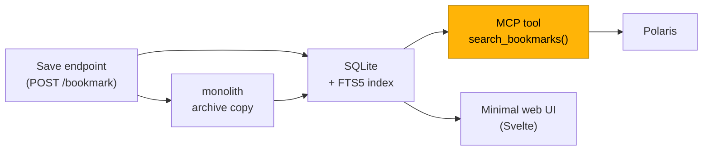
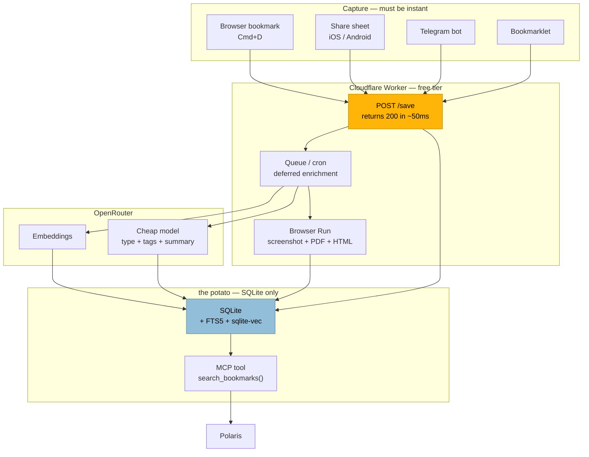
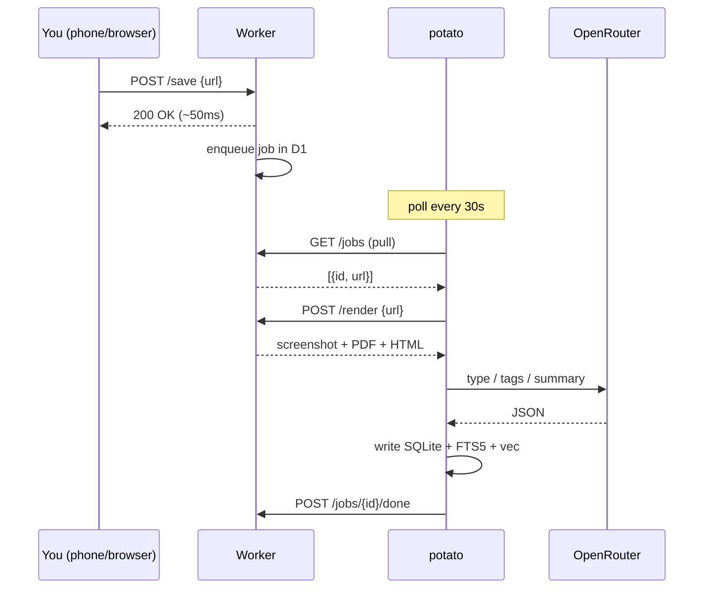
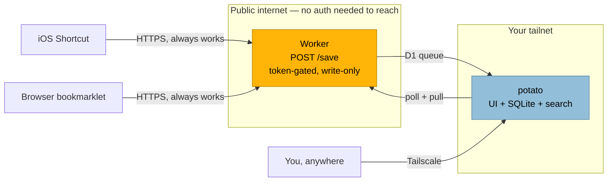

# Research thread: Raindrop, mymind, and the Harbor idea

Verbatim export of the Polaris thread that started this project.

| | |
|---|---|
| Source | Polaris (`potato-remote`, `polaris-polaris-1`) |
| Thread ID | `254329e4-96fc-483d-a21f-7e7d0ed5e085` |
| Title | Raindrop.io Features and Self-Hosted Alternatives |
| Model | `deepseek` |
| Started | 2026-11-03 03:05:42 |
| Last message | 2026-11-03 03:49:18 |
| Cost | $0.0845 |
| Messages | 8 |

> Exported 2026-11-03 from `/data/polaris.db` inside the Polaris Docker container.
> Kept for provenance — the distilled design lives in [design.md](design.md).

---

## 1. Autumn — 2026-11-03 03:05:42

Research raindrop and all of its features. Is there anything like a localhost version of it? I’m a big fan of the service and its pro features, im a current subscriber, but I dunno if I really…. NEED IT long term. I think I could build my own thing. But like. I need inspiration. I need to see if anything like it exists already. Maybe list off all the features that raindrop provides so I have a list of what to look for and if I end up building my own, what I need for myself. I already built Polaris as my version of Kagi assistant. So I’ve proved I can build and support software to a point of really good standards. It would likely end up being something I host on my Tailscale network. The other thing is I just plain don’t use raindrop enough to justify the price, but I do absolutely love the actual feature set of what it is. So I want the service. I very much want the service. But I need to find a way to get it without paying for it. So the obvious answer is build it myself. So like. I need direction. Do lots of research.

## 2. Polaris — 2026-11-03 03:06:43

## Short version

Don't build it. Not because you can't — you clearly can — but because the thing you'd build already exists, twice, and both are better than what you'd ship in year one. **Karakeep** is Raindrop Pro with the serial numbers filed off, plus AI tagging that runs on a local model. **Linkwarden** is the more polished archivist. Either one costs you $0 and an evening of Docker.

The interesting build is a much smaller one, and I'll get to it.

---

## 1. What Raindrop actually is, feature by feature

Pulled from [raindrop.io](https://raindrop.io/) and the [Pro feature docs](https://help.raindrop.io/premium-features):

**Capture**
- Browser extensions: Chrome, Firefox, Safari, Edge
- Desktop apps: Windows, Mac · Mobile: iOS, iPad, Android
- Bookmarklet, share sheet, drag-and-drop
- Upload media and files — PDFs, images, video
- Import/export (Netscape HTML, Pocket, etc.)
- REST API + **official MCP server** (search/save from Claude, ChatGPT, other AI apps)
- Auto-save from X/Twitter and YouTube favorites

**Organize**
- Collections, nested, with thousands of predefined icons
- Tags, tag merging, filters by type / tag / domain
- Four view modes: Grid, Headlines, Masonry, List
- Manual sorting, batch/bulk actions
- Duplicate finder, broken-link checker
- Reminders and notifications

**Read & annotate**
- Instant preview / reader view (articles, video, browsing without leaving the library)
- Highlights, plus annotations *on* highlights
- Permanent web archive copies
- Full-text search across pages, PDFs, EPUBs, and YouTube transcripts — down to spoken words

**Share**
- Collaboration with per-collection permissions
- Public pages for whole collections, no signup required

**AI**
- Stella assistant — ask questions about your saved content, organize hands-free
- Semantic search, auto-tagging/summarization

**Backup**
- Dropbox & Google Drive, scheduled automatic exports

### The free/Pro split — this is the part that matters

| | Free | Pro |
|---|---|---|
| Bookmarks, collections, tags, devices | Unlimited | Unlimited |
| Nested collections, views, filters | ✅ | ✅ |
| Highlights | ✅ (one source says capped at 3/bookmark — worth verifying) | ✅ + annotations |
| Collaboration & public pages | ✅ | ✅ |
| Import/export | ✅ | ✅ |
| File uploads | 100 MB/mo | 10 GB/mo |
| **Full-text search** | ❌ | ✅ |
| **Web archive copies** | ❌ | ✅ |
| **Stella AI + semantic search** | ❌ | ✅ |
| **Reminders** | ❌ | ✅ |
| **Duplicate + broken-link finders** | ❌ | ✅ |
| **Automatic backups** | ❌ | ✅ |

Price: **$3/mo or $28/yr** — $2.33/mo effective, break-even at 9.3 months ([ContextBolt, checked Sept 2026](https://contextbolt.com/blog/raindrop-pricing/)). Over five years that's $140. Over ten, $280.

**Read that table again.** Every single Pro-only feature is a *server-side capability* — search index, archive storage, AI, cron jobs. None of them are UI polish. Which means: the free tier is already a complete bookmark manager, and the Pro tier is exactly the set of things that are annoying to build. That's not an accident.

Also worth knowing: on downgrade you keep bookmarks, collections, tags, highlights — but archives go inaccessible and are **permanently deleted after about a month**, and full-text search stops working ([help.raindrop.io](https://help.raindrop.io/premium-features)). So it's a one-way door on the archive.

---

## 2. The self-hosted landscape

Four real options, all actively maintained as of this month:

```ui
{"c":"compare","cols":["Karakeep","Linkwarden","linkding","Shiori"],"pick":0}
{"row":"Stars","v":["30.3k","20.3k","11.4k","11.7k"]}
{"row":"License","v":["AGPL-3.0","AGPL-3.0","MIT","MIT"]}
{"row":"Stack","v":["Next.js + Postgres + Meilisearch + Puppeteer","Next.js + Postgres + Meilisearch + Playwright","Django + SQLite","Go single binary"]}
{"row":"Full-text search","v":["✅ + semantic","✅","✅ (basic)","✅ (basic)"]}
{"row":"Web archiving","v":["✅ monolith + yt-dlp video","✅ screenshot + PDF + HTML","✅ HTML or Wayback","✅ offline archive"]}
{"row":"AI tagging","v":["✅ local via Ollama","✅ local","❌","❌"]}
{"row":"Browser ext.","v":["Chrome/FF/Safari","Chrome/FF","Chrome/FF","Chrome/FF (beta)"]}
{"row":"Mobile apps","v":["iOS + Android","iOS + Android","PWA","PWA"]}
{"row":"Footprint","v":["Heavy — 2-4 GB RAM","Heavy — 2-4 GB RAM","Light — ~1 container","Lightest — 1 binary"]}
{"row":"Last commit","v":["2026-11-02","2026-10-26","2026-09-13","2026-10-26"]}
```

**Karakeep** ([repo](https://github.com/karakeep-app/karakeep)) is the closest match to what you're describing. Its own README lists Raindrop as an alternative and notes "it's not self-hostable though" — that's the whole pitch. Beyond Raindrop parity it adds OCR on images, RSS auto-hoarding, rule-based auto-management, CLI + agent skills, and importers from Chrome/Pocket/Linkwarden/Omnivore. It's the most actively developed of the four (2,409 commits, commit today).

**Linkwarden** ([repo](https://github.com/linkwarden/linkwarden)) is the preservation-first one — screenshot + PDF + single-file HTML on every save, reader view with highlight-and-annotate, optional Wayback submission. If the *archive* is the Pro feature you actually care about, this is the better-engineered answer.

**linkding** ([repo](https://github.com/sissbruecker/linkding)) and **Shiori** ([repo](https://github.com/go-shiori/shiori)) are the minimal ones. linkding is a single Django container on SQLite; Shiori is a single Go binary. Neither has AI or semantic search. Both are genuinely pleasant and both will run on almost nothing.

---

## 3. The constraint you need to check first: the potato

Karakeep and Linkwarden both require **Postgres + Meilisearch + a headless Chromium** (Puppeteer/Playwright) alongside the app. That's a 2–4 GB RAM floor in practice — there's a [known issue where a large import exhausted 2 GB on a 4 GB Hetzner VPS](https://github.com/karakeep-app/karakeep/issues/1748). Neither docs page states minimum specs, which tells you something about how much they expect you to already know.

Your Le Potato is already running her-go, SearXNG, AdGuard, and Unbound. Adding a Next.js app, Postgres, Meilisearch, *and* a headless browser to that box is not going to be a good time — and headless Chromium on ARM is its own adventure.

So the honest fork:

- **Potato stays as-is** → linkding or Shiori. Both are happy in a few hundred MB.
- **You want Karakeep/Linkwarden** → run it on your desktop (3600 + RX570 is wildly overqualified) or a $5/mo VPS, and reach it over Tailscale. Which is exactly the setup you already have for Polaris.

---

## 4. If you build it anyway — here's the real cost breakdown

You asked for direction, so let me be blunt about where the effort actually goes, because it's not where people expect:

**Cheap (a weekend each)**
- Metadata scraping — OpenGraph tags, favicon, title. `httpx` + `selectolax`, done.
- Full-text search — SQLite **FTS5** is built into Python's stdlib and handles this fine at your scale. You do not need Meilisearch for one user.
- Archiving — shell out to [`monolith`](https://github.com/Y2Z/monolith) or SingleFile CLI. One subprocess call.
- Reader view — Mozilla's Readability.js, or `trafilatura` in Python.
- Tags, collections, notes — a schema and some CRUD.

**Expensive (weeks, then forever)**
- **The browser extension.** Manifest V3, cross-browser, store review, and it breaks every time Chrome changes something. This is the single biggest reason not to build your own. Mitigation: skip it. Use a bookmarklet, a share-sheet shortcut, or [floccus](https://floccus.org/) to sync browser bookmarks in.
- **Mobile.** Don't. Make it a PWA.
- **AI tagging.** You already have this — you have an agent stack and MCP servers. This is the one part where you're genuinely ahead of the off-the-shelf tools.
- **Maintenance.** This is the real bill. Karakeep has 599 open issues and a full-time-ish maintainer. You'd be signing up to be that person for one user.

**The thing nobody warns you about:** you'd be rebuilding Karakeep, badly, for about eighteen months, and then you'd discover Karakeep and feel stupid. I've watched this happen to a lot of good engineers.

---

## 5. What I'd actually do

**Step 1 — check whether you even need Pro.** You said you don't use Raindrop enough to justify the price. The free tier has unlimited bookmarks, collections, tags, devices, collaboration, and import/export. The only things you'd lose are search-inside-pages, archives, AI, and reminders. If you're saving 20 links a month and mostly re-finding them by title, **free is genuinely enough** and the answer is "downgrade," not "build." Test it for a month before you write a line of code.

**Step 2 — if you want the Pro features, self-host Karakeep.** Not on the potato. On the desktop or a VPS, behind Tailscale. It gets you full-text search, archiving, AI tagging with Ollama, mobile apps, and a browser extension — the entire Pro feature list — for the cost of an evening. You'll learn more about the problem space in that evening than in a month of designing your own schema.

**Step 3 — the build that's actually worth your time.** Here's the insight: you don't want a Raindrop clone. You want **Polaris to be able to search your bookmarks.** You already have the agent harness, the MCP server pattern, and the Tailscale network. So:



That's a table, an FTS5 index, a save endpoint, an archive subprocess, and one MCP tool. A weekend, maybe two. It's the 20% of Raindrop you'd actually touch, it plugs into the thing you already built, and it doesn't require you to maintain a browser extension for the rest of your life. If it turns out you want more, you migrate to Karakeep and lose nothing.

**One thing to check before you cancel:** Raindrop ships an official MCP server, listed on their homepage. Whether it's gated behind Pro isn't stated on any page I read — but if it's on the free tier, Polaris can already search your Raindrop library today, and the whole build becomes optional.

---

**The uncomfortable math:** $28/year is roughly 45 minutes of your time at any reasonable contracting rate. You will spend 40+ hours on this. Build it because you want to build it and because the Polaris integration is genuinely yours — not because it's the cheaper path. It isn't. But the MCP-tool version is the one where the effort buys you something no product can sell you.

## 3. Autumn — 2026-11-03 03:13:02

Ok let’s also look into my mind. That’s another inspiration I have. I’d likely build this SQLite backend, using remote models through openrouter for ai stuff. We could use a Cloudflare worker for the complicated rendering stuff. Maybe. The device (potato) is compute constrained and barely has any memory left. I do want something like an easy way to save though. That’s the most important part. See raindrop is just so easy. And my mind is even easier.

## 4. Polaris — 2026-11-03 03:14:00

## mymind is a different product than Raindrop — and that changes the build

Raindrop is a *library*. mymind is a *gesture*. That distinction is the whole design brief.

From [mymind.com](https://mymind.com/) and a [verified Oct 2026 review](https://www.marqly.com/blog/mymind-review-2026):

**What it does**
- One inbox for notes, bookmarks, articles, images, quotes, highlights
- **No filing, no folders, no tags** — AI identifies what each item *is* (article / product / book / recipe / tweet) and organizes it
- Smart Spaces — auto-assembled collections, also creatable from a search
- AI summaries, image text recognition (OCR), object/color/brand recognition
- Associative search: by color, keyword, brand, date — "personal search engine"
- Serendipity — resurfaces old saves for keep-or-forget
- Top of Mind — pinned items on open
- Focus Mode, reading mode, article backup, PDF analyzer, Same Vibe (visual similarity)
- Bidirectional linking between notes
- Read/write API (beta since July 2026)

**Pricing** — and this is the part that matters for your decision:

```ui
{"c":"compare","cols":["Guest","Bookmarker","Student of Life","Mastermind"]}
{"row":"Monthly","v":["$0","$4.99","$7.99","$12.99"]}
{"row":"Yearly","v":["—","—","$79","$129"]}
{"row":"Cards","v":["100","Unlimited","Unlimited","Unlimited"]}
{"row":"AI tagging","v":["❌","❌","✅","✅"]}
{"row":"OCR / Smart Spaces","v":["❌","❌","✅","✅"]}
{"row":"AI summaries","v":["❌","❌","❌","✅"]}
{"row":"Reading mode + article backup","v":["❌","❌","❌","✅"]}
{"row":"PDF analyzer / Same Vibe","v":["❌","❌","❌","✅"]}
```

**The thing that should decide this for you:** mymind has **no bulk import, no sharing of any kind, and export is one-way** — a `cards.csv` plus files, only from desktop Chrome or Edge, with no re-import format ([Marqly](https://www.marqly.com/blog/mymind-review-2026)). It's a roach motel. Raindrop at least lets you leave cleanly. That's a real argument for owning your data, independent of price.

Combined, you're paying **$157/year** for the two. Over five years that's $785.

---

## Your architecture instinct is right — here's the refined version

You've got the constraint exactly backwards from how most people build this. The potato can't do the work, so **don't put the work on the potato.** Put only the thing that must be local (your data) there, and push every expensive operation to the edge.



**Why this split works:** the potato's only job is holding a SQLite file and answering queries. That's a few tens of MB of RSS. Everything that would have eaten your remaining RAM — headless Chromium, an embedding model, an LLM — happens on Cloudflare or OpenRouter and comes back as a row insert.

### The Cloudflare piece, priced

Your instinct to use a Worker for rendering is correct, and cheaper than you'd guess. [Browser Rendering pricing](https://developers.cloudflare.com/browser-run/pricing/):

- **Workers Free: 10 minutes of browser time per day**, 3 concurrent browsers
- Workers Paid: 10 hours/month included, then **$0.09/browser hour**

At ~4 seconds per page render, 10 free minutes/day is roughly **4,500 renders a month**. You will never approach that. Screenshot + PDF + single-file HTML for every save, free, forever, on a box that isn't yours.

If you ever need D1 as a buffer: [5 GB storage, 5M rows read/day, 100k rows written/day](https://developers.cloudflare.com/d1/platform/pricing/) on free. Also plenty.

### The OpenRouter piece, priced

At a cheap model (~$0.15/M in, ~$0.60/M out — Gemini Flash class), a 2,000-token page in and 300-token structured output out costs about **$0.00048 per bookmark**. That's **$0.48 per thousand saves**. Two thousand bookmarks a year costs you **96 cents**.

This is the number that reframes everything: the AI part of mymind's Mastermind tier — the part they charge $129/year for — costs you under a dollar annually at your volume. The subscription isn't paying for inference. It's paying for the UI and the save gesture.

---

## The save path — this is the actual product

You said it yourself: *"I do want something like an easy way to save though. That's the most important part."* Everything else is a weekend. This is the part that decides whether you use the thing.

Here's a wide spread, from most-maintenance to least:

**1. floccus + a browser bookmark folder** — *the sneaky-best option*
You save with the native `Cmd+D`, into a "Inbox" folder. [floccus](https://floccus.org/) syncs that folder to your API on a timer. Zero new UI, zero extension to maintain, works in every browser, and the save gesture is one you already have muscle memory for. The app then enriches each arrival. This is the lowest-friction, lowest-maintenance path that exists, and almost nobody thinks of it because it doesn't look like a product.

**2. Telegram bot** — *the one you're already good at*
You've built Mira. A bot is a `POST` with a photo, a link, or a forwarded message, and Telegram is on every device you own with a share sheet that already works. Send a link to a chat, it's saved. Bonus: it's the only option here that also handles "save this thought" as naturally as "save this URL." Given the potato can't run much, a bot is a ~50-line webhook on the Worker.

**3. iOS/Android share sheet → Shortcut → POST**
[Linkwarden ships exactly this](https://docs.linkwarden.app/getting-started/apple-shortcut) and [linkding documents it too](https://linkding.link/how-to/) — proof it's a solved pattern. One Shortcut, one HTTP POST, appears in the share sheet of every app. On Android, a PWA with a `share_target` manifest entry gets you the same thing with no native code.

**4. Bookmarklet**
A one-line `javascript:` URL dragged to your toolbar. Ugly, unkillable, works in every browser including ones that don't allow extensions. Zero maintenance forever.

**5. A browser extension**
The "correct" answer and the one I'd skip. Manifest V3, store review, and it breaks whenever Chrome sneezes. Only worth it if you want the *Raindrop-style* inline save button with a collection picker.

**6. Email-to-save**
Forward anything to `save@yourdomain`. Trivial with Cloudflare Email Routing → Worker. Great for newsletters and receipts, which are exactly the things you'd otherwise never bother saving.

**7. A Tailscale-only "quick save" page**
A single input box at `http://potato:8080/save`, pinned to your phone's home screen. Paste, hit enter, done. No auth needed because it's inside your tailnet. This is the "I just need it to work on the couch" option.

**7b. The unexpected one:** an NFC sticker on your desk that opens that page. Or a widget. Or a Raycast/Alfred script bound to a hotkey. All the same endpoint.

**My recommendation:** build the endpoint first (`POST /save` taking `{url, note?, image?}`), then wire up **floccus + Telegram** as the two front doors. That covers desktop and mobile, costs you no extension maintenance, and both are things you already know how to build.

---

## The build order

```ui
{"c":"steps","title":"MVP path — each step is independently useful"}
{"i":"POST /save","d":"Accepts url/note/image, writes a row, returns 200 immediately. Nothing else.","t":"1 evening"}
{"i":"SQLite + FTS5","d":"Schema plus a full-text index. FTS5 is in Python's stdlib — no Meilisearch, no extra process.","t":"1 evening"}
{"i":"floccus + Telegram","d":"Two front doors. Now you're actually using it daily.","t":"1 evening"}
{"i":"Worker enrichment","d":"Queue: fetch OG tags, Browser Run screenshot + PDF, OpenRouter type/tags/summary. Write back.","t":"a weekend"}
{"i":"Minimal Svelte UI","d":"Grid of cards, search box, click to open. Resist adding views.","t":"a weekend"}
{"i":"sqlite-vec","d":"Embeddings for semantic search — 'that article about the thing' queries.","t":"1 evening"}
{"i":"MCP tool","d":"search_bookmarks() exposed to Polaris. This is the payoff.","t":"1 evening"}
```

Note what's *not* on that list: no browser extension, no mobile app, no collaboration, no sharing, no bulk import UI. Those are the things that turn a weekend project into a second job.

**On semantic search:** you don't need Meilisearch. [`sqlite-vec`](https://github.com/asg017/sqlite-vec) is a pure-C SQLite extension with no dependencies that stores vectors as ordinary BLOBs in ordinary tables — it runs anywhere SQLite runs, including a Le Potato. FTS5 handles keyword search, sqlite-vec handles "find me the thing that felt like this." Together they cover everything mymind's "personal search engine" does.

---

## The honest read

mymind's $129 tier is charging you for **AI summaries, reading mode, article backup, PDF analyzer, and Same Vibe** — and three of those four are "run a model on the page and store the result," which is $0.48 per thousand saves through OpenRouter. The fourth, Same Vibe, is a cosine similarity query against embeddings you're already generating.

The genuinely hard parts of mymind are the ones you'd be *right* to skip: the visual design, the color-based search, and the fact that it works on a phone without you thinking about it.

So: build the backend, wire floccus and Telegram, and let the save gesture be the thing you obsess over. That's the 20% that gets you 80% of mymind, on a box that can't spare the RAM, for roughly a dollar a year in inference.

And if the UI turns out to be the part you actually miss — that's the signal to pay mymind $79 for Student of Life and keep your own backend as the archive. Which, given their export situation, is a much better position to be in than the reverse.

## 5. Autumn — 2026-11-03 03:39:23

I was thinking have the worker handle the stuff it would be best at and let the potato do the rest. Passing data around is compute cheap on the potato. But something like browser rendering? That’s not cheap lol. I think the worker would be for that. Everything else the potato can handle. All it’s doing is passing data around after all. Talking to APIs. That’s it.

## 6. Polaris — 2026-11-03 03:39:49

You're right, and the correction is narrower than you'd think — but there's one thing in your plan that doesn't work as stated, and it's not about compute.

## The one real problem: the Worker can't call the potato

Your potato is on Tailscale. A Cloudflare Worker is not on your tailnet. It has no route to `potato:8080` — not a slow route, *no* route. So "Worker renders, potato does the rest" implies the Worker has to hand the result back, and it can't reach you to do it.

The fix isn't a tunnel. It's **inverting the direction of the call.**



The potato is the **client**, not the server. It dials out to Cloudflare, never the reverse. No tunnel, no exposed port, no public IP, nothing to firewall. And it means the potato can be asleep, rebooting, or dead and saves still land — they just queue.

That single inversion is what makes your architecture actually work.

## Where the potato actually spends memory

"Passing data around is compute cheap" is true for the I/O — an HTTP fetch, a JSON parse, an OpenRouter call, a SQLite insert. All of that is a few MB of transient buffers.

The spike is **holding a whole page in memory to parse it.** A 4 MB HTML document, parsed into a DOM, is 40–80 MB resident. On a box already running AdGuard, Unbound, SearXNG, and her-go, that's the thing that OOMs you — not the API calls.

Three cheap mitigations, all of which you'd want anyway:

- **Cap the fetch.** `Content-Length` check, abort over ~5 MB. You lose nothing; the archive copy is the Worker's job.
- **Stream to disk, parse from disk.** `httpx` to a temp file, then `selectolax` or `trafilatura` reading from it. Peak RSS stays flat.
- **One job at a time.** A single-threaded worker loop with a `sleep`. Concurrency is what turns a 60 MB spike into a 300 MB one.

Do those and the potato's enrichment loop is genuinely a few tens of MB. You were right.

## The Worker number that actually constrains you

Not memory — **CPU time**. Workers Free gives you **10 ms of CPU per request** ([limits docs](https://developers.cloudflare.com/workers/platform/limits/)); Paid gives 30 s default, configurable to 5 minutes ([changelog](https://developers.cloudflare.com/changelog/post/2025-03-25-higher-cpu-limits/)). Free also caps at 100,000 requests/day.

10 ms is fine for a `fetch()` and a JSON response — waiting on I/O doesn't burn CPU. It is *not* fine for parsing HTML or running Readability. So:

- **Browser Rendering is billed in browser hours, not CPU** — $0.09/hr after 10 free minutes/day ([pricing](https://developers.cloudflare.com/browser-run/pricing/)). Your rendering plan is unaffected by the CPU limit.
- **Do the HTML parsing on the potato**, where you have no 10 ms ceiling. The Worker's job is "render and hand back bytes," full stop.
- If you find yourself wanting to parse in the Worker, that's the signal you've put the wrong thing there.

## What the Worker should own beyond rendering

You're underusing it. It's the only always-on, publicly-reachable thing in this system, which makes it the right home for:

**The save endpoint itself.** This is the important one. If saves go straight to the potato, then a save fails whenever the potato is rebooting — and your potato's fan is dying. Put `POST /save` on the Worker, have it write to D1 and return immediately. Save never fails. The potato catches up later. That's the difference between a tool you trust and one you don't.

**D1 as the job queue** — [5 GB, 5M rows read/day, 100k written/day free](https://developers.cloudflare.com/d1/platform/pricing/). A `jobs` table with `status` is a durable queue with no Redis, no RabbitMQ, no extra process. You'll use maybe 0.1% of it.

**R2 for the archive blobs** — [10 GB-month, 1M Class A ops, 10M Class B, free egress](https://developers.cloudflare.com/r2/pricing/). Screenshots and PDFs go here, not on the potato's SD card. The potato stores a URL. This is how you keep the potato's disk from filling up with 8 MB PDFs.

**Secrets.** The OpenRouter key lives in a Worker secret and gets passed to the potato per-request, or the potato holds its own. Either way, the Worker is where you rotate it.

**Embeddings, free.** Workers AI gives [10,000 neurons/day free on every plan](https://developers.cloudflare.com/workers-ai/platform/pricing/). That's enough for embedding every bookmark you'll ever save. You don't need to pay OpenRouter for vectors — only for the type/tag/summary call, which is the $0.48-per-thousand number from before.

## The revised split

```ui
{"c":"compare","cols":["Cloudflare Worker","the potato"],"pick":0}
{"row":"Role","v":["Always-on front door + renderer","Enrichment worker + database"]}
{"row":"Owns","v":["POST /save, D1 queue, R2 blobs, Browser Run, embeddings","SQLite + FTS5 + sqlite-vec, HTML parsing, OpenRouter calls"]}
{"row":"Reachable from","v":["Public internet","Outbound only — never inbound"]}
{"row":"Fails when","v":["Almost never","Fan dies, reboot, power cut"]}
{"row":"Data at risk","v":["Queue entries (durable in D1)","The library itself — back this up"]}
{"row":"Cost","v":["$0 on free tier","$0"]}
```

The one asymmetry worth naming: **the potato holds the irreplaceable thing.** The Worker holds a queue you could lose without caring. So the backup story is the potato's SQLite file — nightly `sqlite3 .backup` to R2, or just a `litestream`-style continuous replication. That's a 20-line cron, and it's the only part of this system where a failure is actually bad.

## What this changes about the build order

Your original instinct — build the potato's enrichment loop first — is now slightly wrong. Build in this order instead:

1. **Worker: `POST /save` → D1.** Saves work immediately, even with nothing behind it.
2. **Potato: poll loop + SQLite schema.** Now saves actually land.
3. **Worker: Browser Run endpoint.** Potato calls it, gets bytes, writes to R2.
4. **Potato: OpenRouter enrichment.** Type, tags, summary.
5. **Potato: FTS5, then sqlite-vec.**
6. **MCP tool → Polaris.**

Steps 1 and 2 alone are a working bookmark manager. Everything after is enrichment you can add without ever breaking the save path — which is exactly the property you want, given the hardware.

You had the right instinct about where compute goes. The thing that was going to bite you wasn't compute at all — it was that a Worker and a tailnet can't see each other, and the fix is to stop trying to make them.

## 7. Autumn — 2026-11-03 03:49:05

Oh yeah. I just thought about the issue of if this is hosted on my tailnet, I wouldn’t be able to easily hit it as an api for something like my shortcut thing to quick save stuff. I’d have to navigate to the url every time. This is something interesting to think about. That part would have to be on the worker. See I want the frontend hosted on the potato though. That way I can view everything easily.

## 8. Polaris — 2026-11-03 03:49:18

You've landed on the right split. Let me name it precisely, because the precise version is what keeps this from becoming two apps.

## It's not "frontend vs API" — it's "write path vs read path"



The Worker is **write-only**. It accepts a URL and returns 200. It cannot read your library, list your bookmarks, or search anything. That's not a limitation you're working around — it's the security property that makes putting it on the public internet safe. A token that can only append is a token that's not catastrophic to leak.

The potato is **read-write** and stays on the tailnet. Your UI lives there, your data lives there, and the only thing crossing the boundary is "here's a URL, thanks."

## The thing you got slightly wrong

A Shortcut *can* hit a tailnet IP. Tailscale on iOS exposes your tailnet to the OS, and Shortcuts' "Get Contents of URL" will reach `http://potato:8080/save` fine — [Tailscale even ships Shortcuts actions](https://tailscale.com/docs/features/mac-ios-shortcuts), and [VPN On Demand](https://tailscale.com/docs/features/client/ios-vpn-on-demand) can auto-connect the tunnel when you hit a tailnet address.

So it's not impossible. It's just **fragile in exactly the wrong way.** There's a [known issue where Shortcuts fail if the Tailscale app isn't running in the background](https://github.com/tailscale/tailscale/issues/16240) — and the failure mode is silent. You share a link, the shortcut spins, nothing saves, and you don't find out for three weeks. For the one gesture that has to be instant and trustworthy, "usually works if the VPN happens to be up" is disqualifying.

The Worker gives you: always up, no VPN dependency, no dependency on the potato being awake, and a save that succeeds even mid-reboot. That's worth ~80 lines.

## The consequence you should design around now

Saves land in D1. The potato polls. So there's a **window where a save exists but isn't in your library yet** — 30 seconds if you poll every 30s, up to a few minutes if the potato was asleep.

That's fine, but it has one visible symptom: you save something, open the UI, and it's not there. Two ways to handle it, pick one:

- **Show pending items in the UI.** The potato's poll response includes queued jobs; render them as greyed-out cards at the top. You see the save land immediately, then it fills in. This is the good version.
- **Poll fast when the UI is open.** The UI's own request triggers a poll. Saves appear on next page load. Simpler, slightly worse.

Don't skip this. "I saved it and it vanished" is the exact failure that makes you stop trusting a tool.

## The one place the split gets awkward

**Public collection sharing.** Raindrop and mymind both let you share a collection with a link. If the UI is tailnet-only, you can't. Options, in order of effort:

1. **Don't build it.** You're one user. This is my actual recommendation.
2. **Worker renders a read-only page** from a D1 snapshot of one collection. The Worker stays write-only for the API but gets a narrow read path for explicitly-published collections. ~150 lines.
3. **Cloudflare Tunnel + Access** — [cloudflared](https://developers.cloudflare.com/tunnel/) dials out from the potato, no open ports, and Access puts an identity check in front. This gets you the *whole* UI publicly, gated by Cloudflare's auth. Costs nothing, but it's a second way in and a second thing to keep working.

Option 3 is also your answer if you ever want the UI on a device where you can't install Tailscale — a friend's laptop, a work machine, a smart TV. Worth knowing it exists; don't build it on day one.

## What the Worker actually is

Small enough to paste:

```js
export default {
  async fetch(req, env) {
    const url = new URL(req.url);
    if (req.method !== "POST" || url.pathname !== "/save") {
      return new Response("not found", { status: 404 });
    }
    if (req.headers.get("authorization") !== `Bearer ${env.SAVE_TOKEN}`) {
      return new Response("unauthorized", { status: 401 });
    }
    const { link, note } = await req.json();
    if (!link) return new Response("missing link", { status: 400 });

    await env.DB.prepare(
      "INSERT INTO jobs (url, note, status, created_at) VALUES (?, ?, 'queued', ?)"
    ).bind(link, note ?? null, Date.now()).run();

    return new Response(JSON.stringify({ ok: true }), {
      headers: { "content-type": "application/json" },
    });
  },
};
```

That's the whole public surface. Everything else — rendering, enrichment, search, the UI — is behind your tailnet.

Add [Cloudflare's rate limiting binding](https://developers.cloudflare.com/workers/runtime-apis/bindings/rate-limit/) on `/save` (a few requests per minute per IP) and a leaked token becomes an annoyance rather than a bill. Note their caveat: limits are approximate and applied per Cloudflare location, so treat it as abuse-dampening, not a hard guarantee.

## The shape of the whole thing

```ui
{"c":"compare","cols":["Worker (public)","potato (tailnet)"],"pick":0}
{"row":"Can write","v":["✅ append only","✅"]}
{"row":"Can read library","v":["❌ never","✅"]}
{"row":"Serves UI","v":["❌","✅"]}
{"row":"Needs Tailscale","v":["❌","✅"]}
{"row":"Survives potato downtime","v":["✅ queues","—"]}
{"row":"Attack surface if token leaks","v":["Someone can add junk","n/a"]}
{"row":"Lines of code","v":["~80","everything else"]}
```

You got to the right answer. The refinement is just: make the public half *incapable* of reading, so that the only thing you're trusting the internet with is the ability to add a row. Then the frontend on the potato is exactly as private as you wanted it, and the Shortcut is exactly as reliable as you needed it.

---

## Sources cited in the thread

- [Raindrop.io — All-in-one bookmark manager](https://raindrop.io/)
- [How Much Does Raindrop.io Cost? Free vs Pro Pricing (2026)](https://savethisone.com/blog/raindrop-pricing-2026)
- [Raindrop Pricing in 2026: Free vs Pro, Monthly vs Annual - ContextBolt](https://contextbolt.com/blog/raindrop-pricing/)
- [Raindrop.io Review 2026 — Pricing, Pros & Cons - Marqly](https://www.marqly.com/blog/raindrop-review-2026)
- [Raindrop.io vs Mailist: Which Bookmark Manager Is Right for You?](https://mailist.app/blog/raindrop-io-vs-mailist)
- [Raindrop.io Difference between Pro full-text search and Free search?](https://www.reddit.com/r/raindropio/comments/1lwdg0u/raindropio_difference_between_pro_fulltext_search/)
- [Members - Raindrop.io Help](https://help.raindrop.io/collaboration)
- [Raindrop Review 2026: Is This Bookmark Manager Worth It?](https://dockshare.io/apps/raindropio)
- [a Raindrop alternative for 2026 - Becoming](https://usebecoming.com/alternatives/raindrop/)
- [Eagle vs Raindrop: which should you use in 2026? - Fabric.so](https://fabric.so/comparison/eagle-vs-raindrop)
- [Best Raindrop.io Alternatives 2026: 8 Tools Compared | TabMark Blog](https://tabmark.dev/blog/raindrop-alternatives/)
- [8 Best Raindrop.io Alternatives in 2026, Compared - ContextBolt](https://contextbolt.com/blog/best-raindrop-alternatives/)
- [Alternative to raindrop.io : r/foss - Reddit](https://www.reddit.com/r/foss/comments/1f5mvh4/alternative_to_raindropio/)
- [Raindrop.io Alternatives (2026): Best Bookmark & Read-Later Apps ...](https://supasidebar.com/blog/raindrop-io-alternatives-2026)
- [Best Raindrop.io Alternatives (2026): 6 Options by Use Case - Tuckii](https://tuckii.app/blog/raindrop-io-alternative)
- [Linkwarden Overview - A Modern Self-Hosted Bookmark Manager](https://prohomelab.com/en/posts/linkwarden/)
- [Open Source Raindrop.io Alternatives: Top 12 Bookmark Managers](https://alternativeto.net/software/raindrop-io/?license=opensource)
- [GitHub - karakeep-app/karakeep: A self-hostable bookmark ...](https://github.com/karakeep-app/karakeep)
- [Raindrop Alternatives: 6 Bookmark Tools Compared (2026)](https://www.burn451.cloud/alternatives/raindrop)
- [Choosing a Better Bookmark Manager - OpenReplay Blog](https://blog.openreplay.com/choosing-better-bookmark-manager/)
- [Best Free Bookmark Managers 2026: 5 Real Options - Marqly](https://www.marqly.com/blog/best-free-bookmark-managers-2026)
- [Raindrop.io documentation - Raindrop.io Help](https://help.raindrop.io/)
- [Subscribe to Pro — Raindrop.io](https://raindrop.io/pro)
- [linkwarden/linkwarden](https://github.com/linkwarden/linkwarden)
- [Subscription - Raindrop.io Help](https://help.raindrop.io/premium-features)
- [Install Karakeep with Docker | Karakeep](https://docs.karakeep.com/Installation/docker)
- [https://docs.linkwarden.app/self-hosting/installation](https://docs.linkwarden.app/self-hosting/installation)
- [Bug: High memory usage on karakeep worker during large imports ...](https://github.com/karakeep-app/karakeep/issues/1748)
- [How much RAM do you have? And how much are you currently using?](https://www.reddit.com/r/selfhosted/comments/1ftkh9b/how_much_ram_do_you_have_and_how_much_are_you/)
- [Neko: Your Virtual Team Browser – Installation with Docker - Deployn](https://deployn.de/en/blog/neko-install/)
- [kejilion.sh 应用市场 · App Store](https://app.kejilion.sh/)
- [r/docker - Reddit](https://www.reddit.com/r/docker/)
- [Self-Hosted - Fireside.fm](https://feeds.fireside.fm/selfhosted/rss)
- [go-shiori/shiori](https://github.com/go-shiori/shiori)
- [sissbruecker/linkding](https://github.com/sissbruecker/linkding)
- [mymind is the extension for your mind.](https://mymind.com/)
- [A review of My Mind (a second brain tool) - Fatih Arslan](https://arslan.io/2023/01/30/a-review-of-my-mind-a-second-brain-tool/)
- [mymind Pricing 2026: $79/yr Plans — Full Review - Marqly](https://www.marqly.com/blog/mymind-review-2026)
- [MyMind Review: Worth It? - Toolfolio](https://toolfolio.com/articles/mymind-review)
- [MyMind ( private bookmarking tool ) - free alternative? : r/artificial](https://www.reddit.com/r/artificial/comments/11lqcj1/mymind_private_bookmarking_tool_free_alternative/)
- [mymind – Extend your mind - App Store - Apple](https://apps.apple.com/us/app/mymind-extend-your-mind/id1520332347)
- [Fabric vs. Mymind | Fabric – The workspace that thinks with you](https://fabric.so/comparison/fabric-vs-mymind)
- [mymind.com: Save everything. Organize nothing. - Product Hunt](https://www.producthunt.com/products/my-mind)
- [Pricing · Cloudflare Browser Run docs](https://developers.cloudflare.com/browser-run/pricing/)
- [Introducing pricing for the Browser Rendering API — $0.09 per ...](https://developers.cloudflare.com/changelog/post/2025-07-28-br-pricing/)
- [Cloudflare Browser Run - Headless Browsers for AI Agents](https://www.cloudflare.com/products/browser-run/)
- [Browser Run - Cloudflare Docs](https://developers.cloudflare.com/browser-run/)
- [The 9 Best Browsers for AI Agents in 2026](https://www.kernel.sh/ai-library/best-browsers-for-ai-agents-2026-10)
- [Capture screenshot - Browser Run - Cloudflare Docs](https://developers.cloudflare.com/browser-run/quick-actions/screenshot-endpoint/)
- [Pricing · Cloudflare D1 docs](https://developers.cloudflare.com/d1/platform/pricing/)
- [Compare AI Models: Pricing, Context & Benchmarks - OpenRouter](https://openrouter.ai/models)
- [Pricing - OpenRouter](https://openrouter.ai/pricing)
- [OpenRouter Models Compared: 2026 Guide to Speed and Cost](https://dev.to/kuldeep_paul/openrouter-models-compared-2026-guide-to-speed-and-cost-i0e)
- [OpenRouter API Pricing: 422 Models, Per-Token Rates (October 2026)](https://benchlm.ai/hosts/openrouter)
- [The Open Weight Models that Matter: June 2026 - OpenRouter](https://openrouter.ai/blog/insights/the-open-weight-models-that-matter-june-2026/)
- [AI Model Router Pricing Compared 2026: OpenRouter, LiteLLM ...](https://therouter.ai/blog/ai-model-router-pricing-cost-comparison-2026/)
- [Pricing · Cloudflare Workers AI docs](https://developers.cloudflare.com/workers-ai/platform/pricing/)
- [Cloudflare Workers AI Free Tier 2026 — Free Models, Credits & Limits](https://pricepertoken.com/endpoints/cloudflare/free)
- [Cloudflare Workers AI Tutorial: 10K Free Neurons - FreeAPIHub](https://freeapihub.com/blog/cloudflare-workers-ai-tutorial-free-neurons)
- [Cloudflare Workers AI: Models, Pricing and Examples - mecanik.dev](https://mecanik.dev/en/posts/cloudflare-workers-ai-run-ai-models-at-the-edge-in-2026/)
- [Cloudflare Workers AI Has a Free API: Run AI Models at the Edge ...](https://dev.to/0012303/cloudflare-workers-ai-has-a-free-api-run-ai-models-at-the-edge-with-zero-infrastructure-2ibo)
- [Cloudflare Workers AI free tier — limits, API key and code](https://itsfree.ai/provider/cloudflare-workers-ai/)
- [Linkwarden - An open-source collaborative bookmark manager to ...](https://www.reddit.com/r/selfhosted/comments/1b83l7y/linkwarden_an_opensource_collaborative_bookmark/)
- [LinkThing - App Store - Apple](https://apps.apple.com/us/app/linkthing/id1666031776)
- [How to | linkding](https://linkding.link/how-to/)
- [iOS Shortcut - Linkwarden](https://docs.linkwarden.app/getting-started/apple-shortcut)
- [Karakeep Docker Compose Setup: Self-Hosted Bookmark Manager](https://berkem.xyz/blog/self-hosted-bookmarking-with-raspberry-pi-karakeep/)
- [SQLite-Vector is a cross-platform, ultra-efficient SQLite extension ...](https://github.com/sqliteai/sqlite-vector)
- [Fast vector search for embedded SQLite](https://www.sqlite.ai/sqlite-vector)
- [How sqlite-vec Works for Storing and Querying Vector Embeddings](https://medium.com/@stephenc211/how-sqlite-vec-works-for-storing-and-querying-vector-embeddings-165adeeeceea)
- [Introducing sqlite-vss: A SQLite Extension for Vector Search](https://observablehq.com/@asg017/introducing-sqlite-vss)
- [GitHub - asg017/sqlite-vec: A vector search SQLite extension that ...](https://github.com/asg017/sqlite-vec)
- [Embedded Intelligence: How SQLite-vec Delivers Fast, Local Vector ...](https://dev.to/aairom/embedded-intelligence-how-sqlite-vec-delivers-fast-local-vector-search-for-ai-3dpb)
- [Pricing · Cloudflare R2 docs](https://developers.cloudflare.com/r2/pricing/)
- [Limits · Cloudflare Workers docs](https://developers.cloudflare.com/workers/platform/limits/)
- [Run Workers for up to 5 minutes of CPU-time · Changelog](https://developers.cloudflare.com/changelog/post/2025-03-25-higher-cpu-limits/)
- [Cloudflare Workers Limits: Memory, CPU, and File Workarounds](https://fast.io/resources/cloudflare-workers-limits/)
- [Cloudflare Workers Pricing: $5 Plan vs 3 Rivals [2026] - shattered.io](https://shattered.io/cloudflare-workers-pricing-vs-lambda-azure-functions-cloud-run-2026/)
- [Limits · Cloudflare Workflows docs](https://developers.cloudflare.com/workflows/reference/limits/)
- [Cloudflare Workers and Pages Pricing: What It Really Costs](https://blog.blazingcdn.com/en-us/cloudflares-pricing-for-developers-a-closer-look-at-workers-pages)
- [Preview Local Projects with Cloudflare Tunnel](https://developers.cloudflare.com/pages/how-to/preview-with-cloudflare-tunnel/)
- [Cloudflare Tunnel](https://developers.cloudflare.com/tunnel/)
- [Cloudflare Tunnel: Make Localhost Public Without Port Forwarding](https://www.youtube.com/watch?v=etluT8UC-nw)
- [Cloudflare Tunnel (Remotely connect to HA without opening any ports)](https://www.reddit.com/r/homeassistant/comments/18p3kfy/addon_cloudflare_tunnel_remotely_connect_to_ha/)
- [How to Set Up Cloudflare Tunnel to Access Your Server Without ...](https://runcloud.io/blog/cloudflare-tunnel-setup)
- [Cloudflare Tunnels: Zero-Trust Access Without Port Forwarding](https://builder.aws.com/content/37YOgDWzLW6u9hSiHaUlxuLWnQi/cloudflare-tunnels-zero-trust-access-without-port-forwarding)
- [Tailscale Funnel](https://tailscale.com/docs/features/tailscale-funnel)
- [Tailscale Funnel examples](https://tailscale.com/docs/reference/examples/funnel)
- [Tailscale Funnel: Securely Expose Local Services to the Internet](https://tailscale.com/blog/introducing-tailscale-funnel)
- [Tailscale Funnel: Share Your Web Server with the Public Internet](https://tailscale.com/blog/tailscale-funnel-beta)
- [How to Use Tailscale Funnel for Service Publishing - OneUptime](https://oneuptime.com/blog/post/2026-01-28-tailscale-funnel-service-publishing/view)
- [Make Service accessible externally through tailscale? - Reddit](https://www.reddit.com/r/Tailscale/comments/14b4qym/make_service_accessible_externally_through/)
- [macOS and iOS shortcuts · Tailscale Docs](https://tailscale.com/docs/features/mac-ios-shortcuts)
- [Tailscale ios Connect to server - Reddit](https://www.reddit.com/r/Tailscale/comments/1u9eydk/tailscale_ios_connect_to_server/)
- [iOS: Connect shortcut fails if app is not running in background #16240](https://github.com/tailscale/tailscale/issues/16240)
- [Using VPN On Demand for iOS and macOS · Tailscale Docs](https://tailscale.com/docs/features/client/ios-vpn-on-demand)
- [Tailscale SSH from your phone: full setup (2026) - TermAI](https://termai.sh/blog/tailscale-ssh)
- [Super Basic security question that I'm embarrassed to ask : r/Tailscale](https://www.reddit.com/r/Tailscale/comments/1fbkx3m/super_basic_security_question_that_im_embarrassed/)
- [Cloudflare Rate Limiting - API Abuse Prevention](https://www.cloudflare.com/products/rate-limiting/)
- [Rate Limiting · Cloudflare Workers docs](https://developers.cloudflare.com/workers/runtime-apis/bindings/rate-limit/)
- [Rate limiting rules · Cloudflare Web Application Firewall (WAF) docs](https://developers.cloudflare.com/waf/rate-limiting-rules/)
- [Rate limiting best practices - WAF - Cloudflare Docs](https://developers.cloudflare.com/waf/rate-limiting-rules/best-practices/)
- [Advanced Rate Limiting & Brute Force Protection - Cloudflare](https://www.cloudflare.com/en-ca/application-services/products/rate-limiting/)
- [What Is Rate Limiting? | Rate Limiting and Bot - Cloudflare](https://www.cloudflare.com/learning/bots/what-is-rate-limiting/)
